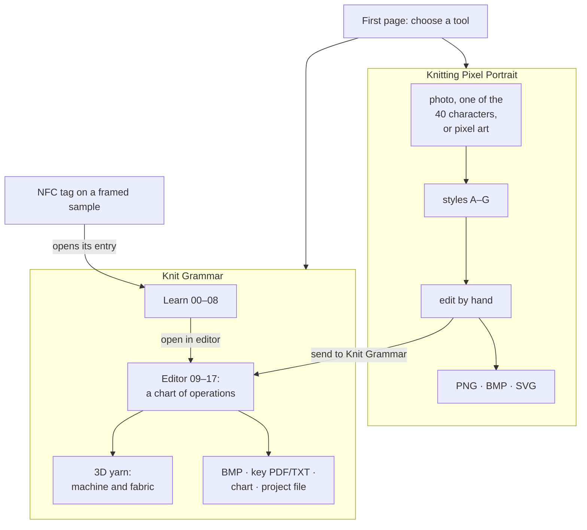
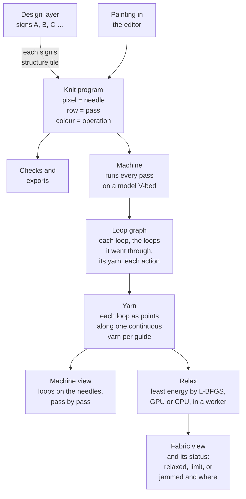

# KnittingPixelArtEditor

Two tools for machine knitting, chosen on the first page:

- **Knitting Pixel Portrait** (`#portrait`): turn a portrait into two-colour pixel art for knitting. One cell is one stitch.
- **Knit Grammar** (`#grammar`): learn how a V-bed flat knitting machine works, and write knit programs as bitmaps:
  one pixel is one needle, one row is one carriage pass, each colour is an operation.

Live at **https://nijatm.github.io/KnittingPixelArtEditor/**

It is free and runs entirely in the browser. Your photos and patterns never leave your device: face detection
(MediaPipe) and all image processing happen locally.

Nijat Mahamaliyev · Tailored Materiality Research

## Overview



## Knitting Pixel Portrait

Steps in the sidebar: 00 photo, 01 frame, 02 grid, 03 style, 04 regions, 05 features, 06 background, 07 draw,
08 parts, 09 colours, 10 export, 11 reset.

- **Start from a photo**: drop, paste or choose one. The face is found, framed and turned into every style at once.
- **Start without a photo**: pick one of the team's 40 characters.
- **Open pixel art**: PNG or BMP files open as editable cells, at their own size or enlarged.
- **Change the parts**: hair, eyes, brows, nose, mouth, glasses and facial hair, each with a preview of every option.
- **Edit by hand**: pencil, erase, fill, line, select (move, flip, mirror copy), mirror drawing, undo, bake.
- **Export**: PNG (1-bit), BMP (1/4/8/24-bit) or SVG. The file holds exactly what the editor shows: one pixel
  per stitch, no margin.
- **Autosave**: the last project is kept in the browser, and 11 reset starts over.
- **Send to Knit Grammar**: the finished portrait becomes a knit pattern; you choose what ink and paper do.

### Styles

| | Style | What it does |
|---|---|---|
| A | **Clean avatar** (default) | Built from the team's 40 characters, not traced from the photo. *Custom* uses the hair closest to yours and that character's face, swapping in glasses, facial hair, closed eyes or a grin when your photo shows them. *Prebuilt* shows one character exactly as drawn. Sizes: 25, 50, 72, 80, 96 or 128 stitches square. |
| B | Image-driven avatar | Traced from the photo: paper face, solid hair, drawn features. |
| C | Region poster | Bold shapes, each region cut separately. |
| D | Line portrait | Open skin, drawn contours. |
| E | Tone patterns | Paper, 50 %, 75 % and ink. |
| F | Atkinson tonal | Dithered shading, features kept. |
| G | ML lines | Lines drawn by a model (Informative Drawings, MIT licence; a 15 MB download on first use). |

## Knit Grammar

Learn pages and editor steps share one numbering. Learn: 00 machine, 01 needle, 02 operations, 03 reading,
04 two guides, 05 structures, 06 shaping, 07 sources. Editor: 08 experiments, 09 library, 10 pattern, 11 key,
12 grammar, 13 draw, 14 view, 15 check, 16 export.

- **Learn**: the V-bed machine, the latch needle's knitting cycle, the operations (knit, tuck, float, transfer,
  racking), reading the grammar, two yarn guides, structures and shaping. Interactive line figures and small 3D yarn swatches; every page lists its sources.
  Pages are drafts until reviewed.
- **Editor**: paint operations, not colours. Tools: needle, run, flood, pass, wale, motif (select, move, flip,
  repeat with a shift), pick, mirror, undo. Views: colours, symbols, and a guides view that splits each
  two-guide pass into a YG1 and a YG2 row. Pass numbers and directions, needle numbers.
- **Shape grammar**: paint regions with signs (A, B, C … on a design layer), give each sign a structure (rib,
  garter, tuck moss, eyelets, hold for short rows, double knit …) and an optional outline structure, and the knit
  program is written from the signs as you draw. Any motif you draw can be saved as a new structure.
- **Experiments**: eight ready-made tests (accordion, bubble, cup, ridges, pleats, window, two-yarn picture, your
  own grammar), each with what to look for and what to try.
- **3D yarn**: the program run on a model V-bed, next to the chart. The machine tracks every needle's loops on both
  beds, the yarn guides, knits, tucks, misses and transfers, which loop is drawn through which, and each guide's
  continuous yarn. *Machine* steps through it pass by pass or action by action (needle beds flat or folded into
  the V, held loops on their hooks, transfers as arrows, the fabric made so far). *Fabric* shows the same yarn
  relaxed off the machine, in a background worker: an uncalibrated estimate (yarn length per stitch, bending,
  floats that can't stretch, yarn that can't pass through yarn, each interlock a clasp; the least energy found by
  L-BFGS). Where it can't settle (a loop held over many passes) it says so and where. Picking a stitch in 3D marks
  its cell, and hovering a cell lights its loops. Two rules the class key doesn't state (when transfers happen, how
  two guides travel) are switches marked "to confirm". Patterns up to 300 × 300 cells.
- **Keys**: the class presets (one and two yarn guides; colour key from Computational Textiles, MIT 4.S52/6.S895,
  Spring 2026, Mariana Popescu) and custom keys built from known operations.
- **Open**: BMP / PNG (near colours snap to the key and are listed; others stay and are flagged) and project files.
- **Check**: unknown colours, transfers off the edge, long floats, long-held loops, stacked tucks. These are warnings
  only, with limits you set (defaults: floats over 6 needles, loops held over 12 passes, more than 4 tucks).
- **Export**: 24-bit BMP with the key's exact colours, the grammar key as PDF and TXT, a symbol chart as PNG and
  SVG, and a project file. Patterns are kept in a library in the browser.

### Knitting Taxonomy and the desk reader

The third section (`#taxonomy`) shows framed knit samples as a shelf of spines: sample ID, a mark for the structure
family and one band per yarn in its origin colours. Pointing at a spine shows the sample below (yarns, key values);
a click pins it, "full record" opens every field. Each frame carries an NFC tag holding its address
(`#taxonomy/SMP_0001`, format in [docs/TAG_FORMAT.md](docs/TAG_FORMAT.md)), so a phone opens it directly; the
first tag's old address (`#grammar/learn/taxonomy/frame-01`) still works. At the desk,
`tools/nfc/taxonomy_reader.py` reads tags with a PN532 module on a USB-serial adapter and opens the same address
on the laptop; laying the tag already shown on again flies its frame in again (no Python packages needed).
`write SMP_0001` writes a sample's whole tag (its address and its data, from the records), and `check` and `info`
help set up the reader and tags. On Android Chrome, "scan tags here" in the bar reads tags into the open page (Web
NFC), so tags do not open new tabs.

For an exhibition, `kiosk` runs the same site offline from the built copy (`dist/`) on the laptop, full screen in
Chrome, with the reader beside it: a sample laid on the reader flies in and its full record opens beside a large,
slowly turning preview; lifted off, it goes back to its spine after 3 s. Only tags with a sample's address count,
and while a sample lies there other tags are ignored. The terminal stays open for commands while it runs (`help`):
test tags (type `SMP_0042`, then `lift`), `status`, `check` and `reader` (reconnect), `reload`, `build`, `open` /
`close` the full-screen page, `quit`. `--keys` runs it without a reader (test tags only).

On phones (under 760 px) the section is one page: the preview stays at the top, the summary and the full record
below it, then the view. A finger dragged along the marks lifts them; letting go pins the one under it; a tap is a click.

For now the shelf holds 300 **generated demo samples**: every value is made up and marked so
(`node scripts/taxonomy-demo.mjs` writes them; `SHOW_DEMO` in `src/taxonomy/data.ts` removes them all).
Two more views of the same samples sit beside the shelf: **lineage** (fibres → yarns → samples → structures joined
by lines; pointing at anything lights its whole chain, and the sample row widens under the pointer) and
**performance** (a map of two chosen properties; each mark's outline gives the status of its values, and samples
missing a value sit in a strip in the margin). Search, pinning and the arrow keys work in all three.
The current sample's frame flies from its mark (spine, tick or map mark) to the preview in 3D. Its window shows a yarn model of the sample's
structure (not a photo of the sample): one per structure, relaxed once with the Knit Grammar yarn engine
(`npm run taxonomy:models`), each yarn in its origin colour. A sample with a photo shows the photo first.
The records follow the material_bank v0.2 conventions (Tailored Materiality Group) in our own schema and
vocabulary files (`src/taxonomy/schema`, `src/taxonomy/vocab`); `node scripts/taxonomy-check.mjs` checks them
before every build.

## How it works

Both tools are static pages: TypeScript built with Vite, no server, no UI framework. Slow work runs in Web Workers
so the page stays responsive.

**Portrait**: the photo is read in the browser, MediaPipe finds 478 face points and the hair, skin and clothes
regions, the face is framed, and a worker turns the frame into each style's cells. Hand edits are kept on their
own layer over those cells, so changing a slider or style keeps them.

**Knit Grammar**, from chart to relaxed fabric:



Every effect in the fabric view (curling, gathering, bulging) comes out of the model's rules; none is written in.
The details, with a diagram for each part, are in [`docs/ARCHITECTURE.md`](docs/ARCHITECTURE.md).

## Run it

```sh
npm install
npm run dev        # http://localhost:5173/KnittingPixelArtEditor/
npm run build      # typecheck + production build into dist/
npm run preview    # serve dist/ the way GitHub Pages will
```

Pushing to `main` deploys to GitHub Pages (`.github/workflows/deploy.yml`).

The clean avatar's library in `public/avatars/` is generated from the folder of 40 characters, which stays
outside the repo. To rebuild it (needs numpy, scipy and Pillow):

```sh
python3 scripts/build-avatar-library.py <portrait-40-multi-resolution folder>
```

The NFC desk reader (macOS or Linux, Python 3):

```sh
python3 tools/nfc/taxonomy_reader.py                 # wait for tags and open their addresses
python3 tools/nfc/taxonomy_reader.py check           # print the PN532's firmware version
python3 tools/nfc/taxonomy_reader.py info            # print a tag's address and data
python3 tools/nfc/taxonomy_reader.py write SMP_0001  # write a sample's tag from the records (needs node)
npm run build && python3 tools/nfc/taxonomy_reader.py kiosk   # the exhibition kiosk (start_kiosk.command)
```

## Documentation

| File | What it holds |
|---|---|
| `README.md` | What the project does, how to run it, where the code is |
| [`docs/ARCHITECTURE.md`](docs/ARCHITECTURE.md) | Technical structure: modules, data flow, the data model, the machine, yarn and relax models, storage, limits |
| [`MODELS.md`](MODELS.md) | Every model file and third-party library, where it comes from, its license |
| `SPEC.md`, `design/DESIGN.md`, `RESEARCH.md`, `HANDOFF.md` | Planning notes and build log of the portrait tool (2026-10-09 to 10-16), kept as written |

## Code map

| What | Where |
|---|---|
| Chooser and routing | `src/app.ts` |
| **Portrait** | |
| Import, pixel-art detection | `src/importer.ts`, `src/pixelart.ts` |
| Face points and regions (MediaPipe) | `src/detect.ts`, `src/pipeline/landmarks.ts`, `src/pipeline/glasses.ts` |
| Framing | `src/frame.ts` |
| Photo preparation (crop, tone, regions, even light) | `src/pipeline/prep.ts`, `src/pipeline/light.ts`, `src/pipeline/raster.ts` |
| Clean avatar: part library, matching, composing | `scripts/build-avatar-library.py`, `public/avatars/`, `src/pipeline/clean.ts` |
| Image-driven avatar and the photo styles | `src/pipeline/avatar.ts`, `styles.ts`, `stamps.ts`, `features.ts` |
| ML lines | `src/pipeline/ml.ts`, `scripts/convert-informative-drawings.py`, `public/models/` |
| Rendering off the main thread | `src/worker.ts` |
| Editor | `src/editor.ts` |
| Export | `src/export.ts` |
| Autosave, and the copy kept when the page closes | `src/store.ts`, `src/exitcopy.ts` |
| Interface | `index.html`, `src/main.ts`, `src/style.css`, `src/ui/controls.ts` |
| **Knit Grammar** | |
| Operations, keys, symbols | `src/grammar/ops.ts` |
| Patterns, editor, rendering, checks | `src/grammar/pattern.ts`, `editor.ts`, `render.ts`, `checks.ts` |
| Files and library | `src/grammar/io.ts`, `src/grammar/library.ts` |
| Shape grammar, structures, experiments | `src/grammar/structures.ts` |
| Machine, yarn | `src/grammar/machine.ts`, `yarn.ts` |
| Relaxation (CPU, GPU) and its worker | `src/grammar/relax.ts`, `relaxgpu.ts`, `knit.worker.ts` |
| 3D view | `src/grammar/view3d.ts` |
| Learn pages, figures, 3D swatches | `src/grammar/learn.ts`, `figures.ts`, `swatch3d.ts`, `src/hl.ts`, `src/vendor/hairline/` |
| Knitting Taxonomy | `src/taxonomy/` (`main.ts`, `view.ts`, `shelf.ts`, `lineage.ts`, `perf.ts`, `data.ts`, `core.js`, `figure.ts`), `scripts/taxonomy-*.mjs` |
| Taxonomy 3D frame and yarn models | `src/taxonomy/stage.ts`, `model.ts`, `data/models/`, `scripts/taxonomy-models.ts` |
| Interface | `src/grammar/ui.ts`, `src/grammar/main.ts` |
| **Other** | |
| NFC desk reader | `tools/nfc/` |
| Build: copy the MediaPipe runtime into `public/` | `scripts/copy-runtimes.mjs` |
| Python prototypes of the portrait styles | `research/prototype/` |
| UI mockup | `design/` |

## License

Code: MIT (`LICENSE`). Models and other third-party files keep their own licenses — see `MODELS.md`.
The line figures use the hairline kernel by Lucas Marques (MIT, vendored in `src/vendor/hairline/` with its
license); the 3D views use three.js (MIT).

## AI usage

Made by NijatM with Claude Code CLI (version 2.1.289), using the Claude Opus 5.5 model at xhigh effort.
