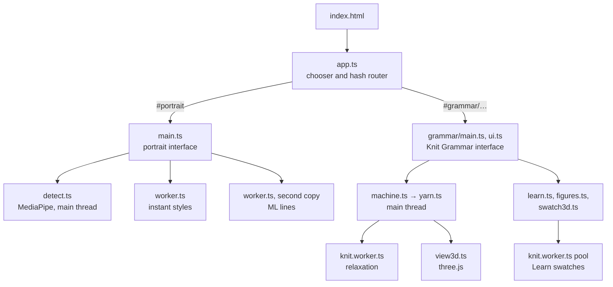
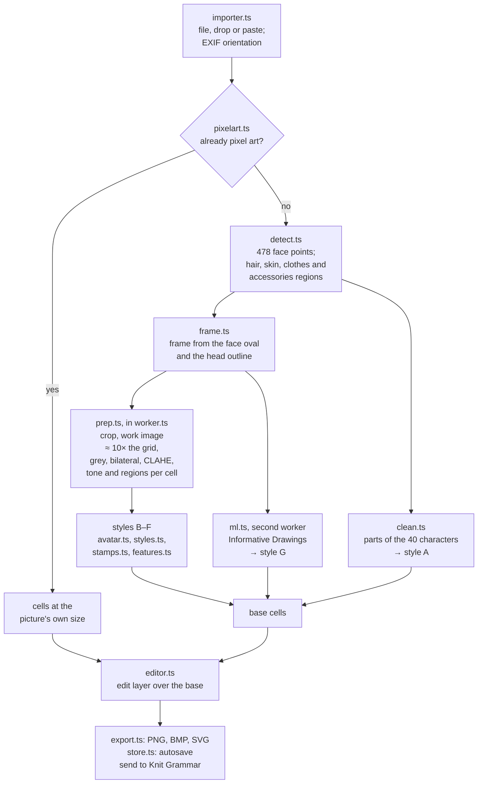
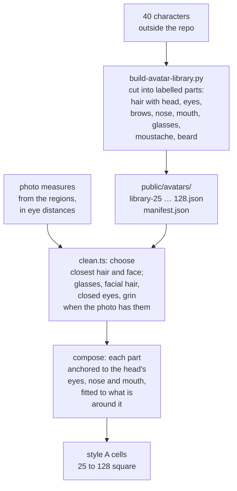
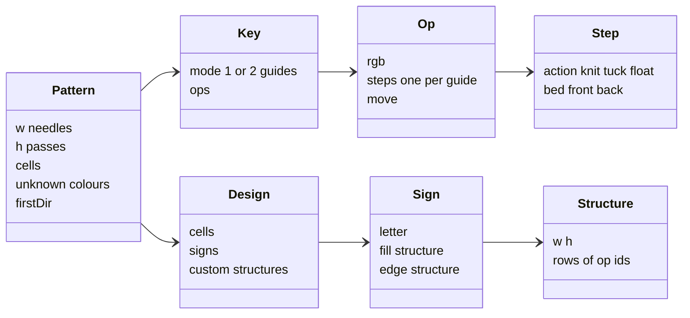
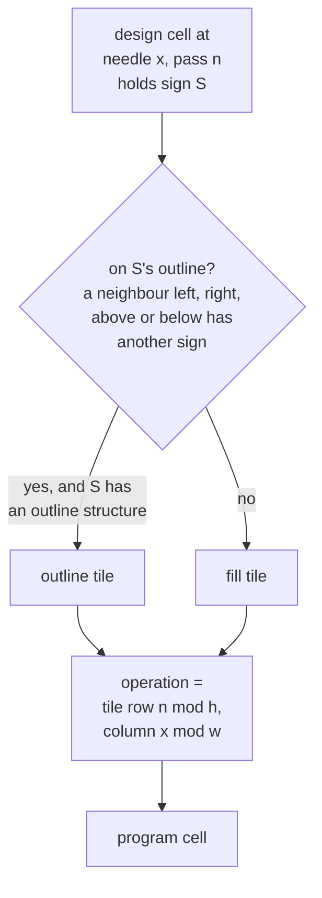
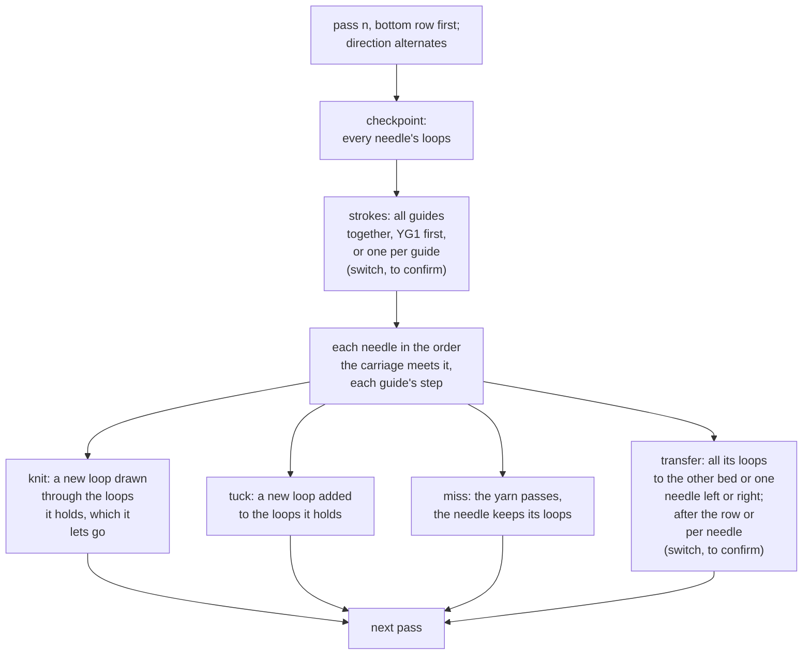
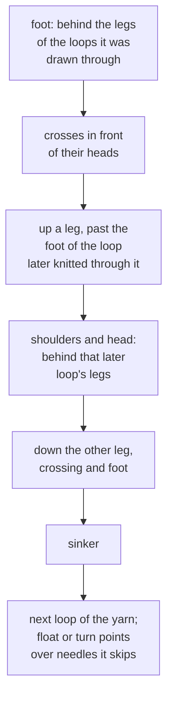
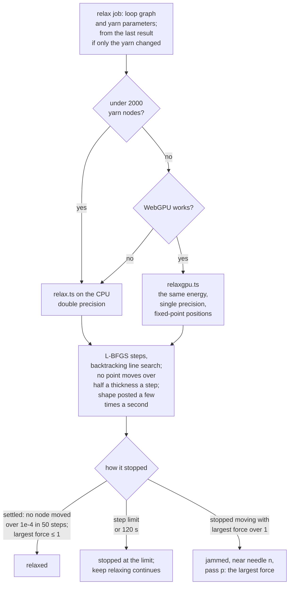
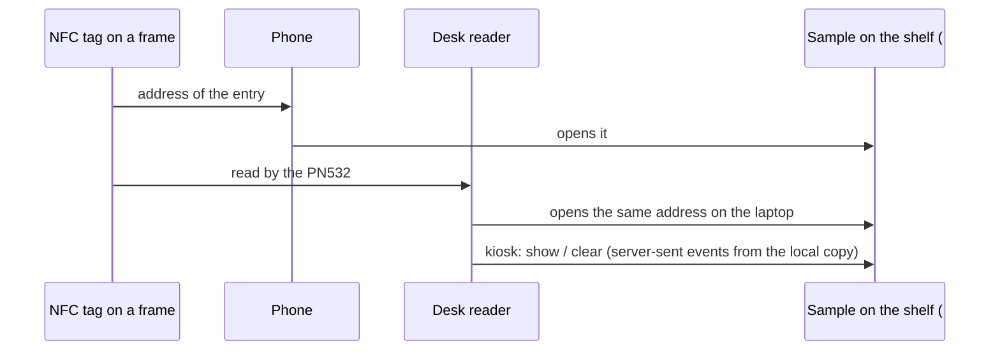

# Architecture

How KnittingPixelArtEditor is built: the modules, how data moves through each tool, and the models behind the
Knit Grammar 3D view. What each tool does for the user is in the [README](../README.md).

Contents: [Stack](#stack) · [Modules](#modules) · [Portrait pipeline](#portrait-pipeline) ·
[Clean avatar](#clean-avatar) · [Knit Grammar data](#knit-grammar-data) · [Shape grammar](#shape-grammar) ·
[Machine](#machine) · [Yarn](#yarn) · [Relaxation](#relaxation) · [3D view](#3d-view) · [Learn](#learn) ·
[Knitting Taxonomy](#knitting-taxonomy) · [Storage](#storage) · [Checks](#checks) · [Testing](#testing) ·
[Limits and open points](#limits-and-open-points)

## Stack

- **Language and build**: TypeScript 7, Vite 8 (ES modules, workers as ES modules, target ES2022). No UI framework:
  the DOM is written by `src/main.ts` and `src/grammar/ui.ts` / `main.ts`.
- **Drawing**: canvas 2D for the pixel views and charts; three.js for the 3D views; the vendored hairline kernel for
  the line figures; WebGPU for the fabric relaxation where the browser has it.
- **Libraries**: `@mediapipe/tasks-vision` (face points, regions), `onnxruntime-web` (ML lines), `three`,
  `@fontsource/ibm-plex-mono`. Sources and licenses: [MODELS.md](../MODELS.md).
- **Self-hosted**: models live in `public/models/`; `scripts/copy-runtimes.mjs` copies the MediaPipe WASM into
  `public/mediapipe/` before `dev` and `build` (git-ignored); Vite bundles ONNX Runtime's WASM. No CDN, no server.
- **Deploy**: GitHub Actions on every push to `main` runs `npm ci` and `npm run build` (`tsc --noEmit` + Vite) and
  publishes `dist/` to GitHub Pages under `/KnittingPixelArtEditor/`.

## Modules

`src/app.ts` shows the chooser and routes by hash. Each tool's code is loaded the first time it opens.

Data modules (`machine.ts`, `yarn.ts`, `relax.ts`, `pattern.ts`, `structures.ts`, `ops.ts`, `editor.ts` in both
tools) have no DOM, so the same code runs on the main thread and in workers.

## Portrait pipeline

- **Detection** runs once per photo on the main thread (tasks-vision loads its WASM with a script tag), on the CPU:
  the GPU delegate spent about 14 s compiling shaders on the first photo, the CPU answers in about 0.4 s.
- **Preparation** is cached per crop and grid, so sliders only re-run the style. Two worker copies run the same
  file: one for the instant styles, one for ML lines, so a slow model run never holds up the sliders.
- **Even light** (`light.ts`) removes the left–right imbalance a side light puts on the skin: skin tone is measured
  in bands across the face, and only its antisymmetric part is subtracted.
- **Hand edits** are a layer: per cell 0 = auto, k + 1 = colour k forced. The base can be regenerated under it;
  *bake* folds the edits into the base.
- **Export** writes one pixel per cell with no margin: PNG (1-bit indexed), BMP (1, 4, 8 or 24-bit), SVG (row runs
  merged into one path per colour).
- **To Knit Grammar**: the final cells (0 = ink, 1 = paper) go through `sessionStorage`; Knit Grammar opens them as
  a pattern and asks which operation each colour becomes.

## Clean avatar

The default style is put together from the team's 40 drawn characters rather than traced from the photo. The photo
only chooses the parts.

*Prebuilt* skips the composing and shows one character exactly as drawn. Every character rebuilt from its own
parts is pixel-identical to its art at all sizes.

## Knit Grammar data

- A **pattern** is W needles × H passes, stored like an image (row 0 on top); the bottom row is pass 1. A cell holds
  an operation index into the pattern's key, or `UNKNOWN + k` for a colour an import couldn't read (kept as it was).
  Pass 1's direction is stored; passes alternate from there. Up to 600 cells a side.
- An **operation** is composed from a small vocabulary: one step per yarn guide (knit, tuck or float, on the front
  or back bed) and a transfer after it (none, to the other bed, one needle left or right). So every key, preset or
  custom, keeps its machine meaning, its symbol and its Learn page.
- **Keys**: the two class presets (one guide, two guides) and custom keys built from the same operations. Two
  colours of the two-guide key are marked provisional until the lab's script confirms them.
- **Import** reads BMP and PNG pixel by pixel with no colour management, snaps near colours to the key and lists
  them, and keeps the rest as unknown. **Export** writes a 24-bit BMP with the key's exact RGB values.

## Shape grammar

A design layer of signs sits over the program. Each sign names a structure: a small tile of operations. While the
layer is live, every change to it rewrites the program (`generate()` in `structures.ts`).

Tiles repeat from needle 1 and pass 1, so neighbouring regions mesh. Drawing on the program by hand turns the live
layer off, so the hand edits stay. Any rectangle of the program can be saved as a new structure. The eight **experiments** are ready-made designs: signs, structures, a drawing rule, what to look
for and what to try.

## Machine

`machine.ts` runs the program on a model V-bed and records what it makes. Pure data: no DOM, no 3D.

- Knitting an empty needle makes a loop with nothing through it: the cast-on in pass 1, a hole later.
- Loops moved onto a needle that holds loops are stacked on top. A yarn guide turns at the last needle it works.
- A left or right transfer happens on the machine via the other bed and a rack of one needle; here that trip is
  implicit.
- **Recorded** (`Topo`): every loop (pass, needle, bed, kind, cell, operation, guide), the loops it was drawn
  through (bottom of the stack first), the loop that later knitted through it, each guide's loops in yarn order,
  every action in machine order, and each row's checkpoint. After an edit the machine replays only from the first
  changed pass.

## Yarn

`yarn.ts` turns the loop graph into continuous yarn: every loop becomes a run of points along its guide's yarn.
Units are needle pitches.

- Each interlock is a **clasp**: the new loop goes over its parent's head and under its legs. At both crossings the
  strands share one node and sit at their own offsets, in the order of construction. That order can't change, and
  everywhere else yarn can't pass through yarn (next section).
- The same points serve both views: laid out as the machine leaves them (needle pitch across, a fixed course height
  up, held loops on their hooks) for the machine view, and relaxed for the fabric view.
- **Yarn parameters** (labelled, uncalibrated): thickness 0.08–0.3 pitch (default 0.16), yarn per stitch 2.5–6
  pitches (default 4), bending stiffness 0–1 (default 0.5).

## Relaxation

Once off the machine the fabric is free: no gravity, nothing holding it. The yarn takes the shape with the least
energy it can reach.

| Energy term | Stands for |
|---|---|
| Bending | The yarn resists curving: at each point the square of the angle, over the length of yarn around it (a discrete elastic rod) |
| Stitch length | Every stitch keeps its yarn (loop + sinker), set by the loop length |
| Floats and turns | Can't get longer than the machine laid them |
| Contact | No two stretches of yarn come closer than the yarn's thickness, anywhere |
| Fold-back | Consecutive points stay half a thickness apart |
| Barrier | Grows without limit as consecutive points come within a quarter thickness (Li et al., Incremental Potential Contact, 2020) |
| Float side | A float stays on the gap side of the loops it passes |
| Ends | The program has no cast-on or bind-off: pass 1's loops are held together as if cast on, loops left on needles as if bound off |

The constraints are stiff penalties. Friction is not modelled, and nothing is calibrated to a real yarn or machine.

- **Solver**: L-BFGS with a history of 5 (Nocedal & Wright, ch. 7) and the exact gradient. The list of segment
  pairs close enough to touch comes from a hashed grid and is rebuilt when any point has moved half its margin.
- **CPU and GPU**: below 2000 nodes the CPU is quicker (a GPU step costs about 1.5 ms at any small size). On the
  GPU, positions and loop lengths are summed in fixed point (2^-21 pitch) because GPU compilers may reorder float
  arithmetic; where a step's energy change is below single precision, the slope decides (Hager and Zhang's
  approximate Wolfe condition). Gradients are summed with atomic adds, so GPU runs differ in their last bits and
  settle in slightly different places. If a GPU kernel fails to build, the CPU takes over. A big fabric on the CPU
  gets a smaller step budget.
- **Jobs**: a new job replaces the one running. Edits are passed to the 3D view 250 ms after the last change.
- **Checked against published behaviour**, qualitatively, never as measured sizes: rib narrower than jersey, tuck
  moss wider, garter shorter, float stripes narrower, jersey ends rolling toward the face and sides toward the back.
  All agree on strips; in a 30 × 30 square the side curl comes out neutral, as the end roll dominates.

## 3D view

`view3d.ts` draws the yarn with three.js. Every span between two yarn points is one instance of a tube, and the
vertex shader follows the spline through the points around it, so the detail can change with zoom without
rebuilding anything.

- **Machine view**: the needle beds unfolded (back bed on top, as in the symbols) with a slider folding them into
  the V; held loops on their hooks, carriers, transfers as arrows, and the fabric made so far hanging below as the
  takedown pulls it (labelled: not relaxed). Steps pass by pass or action by action.
- **Fabric view**: the relaxed yarn, with the scrubbed pass highlighted and later passes dimmed.
- **Linked**: picking a stitch in 3D marks its cell in the chart; hovering a cell lights its loops.
- Patterns up to 300 × 300 cells. The chart and 3D sit side by side on wide screens, one at a time on narrow ones.

## Learn

- `learn.ts` holds the pages (00–08), each with its sources; pages stay drafts until reviewed. Placeholders in a
  page's HTML become a hairline figure, a 3D swatch, a key table drawn from a preset, or a small grammar example
  with "open in editor".
- **Figures** (`figures.ts`): isometric line drawings on the hairline kernel that answer the pointer.
- **Swatches** (`swatch3d.ts`) run on the editor's own engine: machine, yarn and relaxation. A swatch this small
  is all edge and would roll up, so it is knitted inside a larger piece (5 more needles each side, 4 more passes
  below and above) with the piece around it dimmed. Swatches relax in a pool of knit workers.

## Knitting Taxonomy

- `src/taxonomy/` is its own section (`#taxonomy/<sample_id>`), loaded the first time it opens. `data.ts` bundles
  the records (fibres, yarns, samples: one JSON file each, material_bank ADR-0001) and the vocabularies, and
  derives each yarn's type and origin shares (`core.js`, shared with the node scripts). `shelf.ts` draws the
  spines with the hairline kernel: a straight-on camera gives every spine the same shape, so one path is reused
  and a CSS transform places it; sorting slides them, hit tests use the layout. Each spine is its own small svg in
  a layer over the boards' svg, so the browser moves them as layers while they slide (one svg of 1000 spines was
  repainted whole every frame); outside the phone layout each keeps its layer (`will-change`), and a re-sort only
  moves them, since Safari would otherwise make and paint every layer as the slide starts. `stage.ts` builds every structure's model while the page is idle. `main.ts` holds the state
  (pointed at → after 120 ms current → pinned; the address follows the pin), the band below and the full record.
- Three views share that state through one interface (`view.ts`: lift, current, pin, matches, neighbours for the
  keys, a mark's screen rectangle): the shelf; `lineage.ts`, the four layers on a canvas (fibres and structures in
  vocabulary order, yarns and samples ordered by layered barycentre sweeps, keeping the order with the fewest
  crossings; the sample row is a fisheye solved so the lens centre stays under the pointer; a chain is everything
  up and down from the node pointed at; a finger on the structure row, whose names hang below it, gets the touched
  name in a tag raised above); `perf.ts`, a canvas map of two properties (`AXES`, also the band's key
  values) with margin strips for missing values. Both canvases redraw only when something changes; 1000 samples
  redraw within a frame.
- `stage.ts` is one transparent three.js canvas over the section, in CSS pixels: the current sample's mark in the
  open view hides and its frame (`model.ts`) leaves edge on from the mark's place, turns face on and flies to the preview; the one before
  flies back. Behind the window is the structure's yarn model from `data/models/` (loaded on first use), drawn as
  tubes in origin colours, blends as a twisted stripe. `scripts/taxonomy-models.ts` makes the models: each
  structure's program knitted larger than the window, relaxed with `relax.ts` (its outer two needles and passes
  held flat, as by the frame: `relaxStart`'s fixed coordinates) and cropped to the window. Run it after changing
  the structure vocabulary; `taxonomy-check.mjs` fails when a structure has no model.
- `scripts/taxonomy-demo.mjs` writes the generated demo set (seeded); `scripts/taxonomy-check.mjs` validates every
  record against `src/taxonomy/schema` and the vocabularies and fits each tag (`docs/TAG_FORMAT.md`); it runs in
  `prebuild`. The old Learn address `#grammar/learn/taxonomy/frame-NN` is rewritten to `#taxonomy/SMP_00NN`.
- `tools/nfc/taxonomy_reader.py` talks to a PN532 over a USB-serial adapter (HSU, 115200 baud) with `termios`, so
  it needs no packages. It waits for tags and opens each address in one reused browser window, survives the
  adapter being unplugged and plugged back in, and can `check` the reader, print a tag's `info`, or `write` an
  address to an NTAG21x tag. `start_reader.command` launches it on macOS. The HSU wake-up bytes go out in the same
  write as the first command (a PN532 just powered slept through them when a pause came between, and stayed silent
  as if unwired), and a command met with silence is sent once more behind them; when it still gets no answer it
  names the program holding the port, if any (a browser's serial tester). Before each look it switches the field
  off and on (on the rig, a tag once listed was not found again while it lay there); it lists up to two tags per
  look and reads a tag only until its address (5 pages instead of ~40); the same address again is set with `/again` after
  it, which the page takes as "fly the frame in again". `write SMP_####` gets the bytes from
  `scripts/taxonomy-tag.mjs` (`core.js`'s `tagPayload`, `ndefMessage`, `tlv`: the site's own code), writes them
  and reads them back.
- `kiosk` serves `dist/` on 127.0.0.1 and `…/reader`, a server-sent event stream (`show SMP_####` / `clear`; the
  latest state on connect). `Rig` holds the slot's rules: tags without a sample's address are ignored; while the
  shown tag is seen (asked for by its UID first, so whatever else lies near cannot hide it), others are ignored; once it is gone, a new sample takes over at once, else `clear` after 3 s.
  The page (`?kiosk`) hides the band and the ways out of the section, moves the preview into a large panel beside
  the full record, shows a sample only by the reader or a click, and asks `stage.ts` to swing the frame. The
  terminal is a console meanwhile (`Console`): commands go to the kiosk's loop, the only thread using the reader;
  test tags pass through `Rig` like real ones; `reload` is a one-off event (not replayed to a page connecting).
- Touch (`main.ts`): a finger only lifts (no dwell); letting go after a drag pins the one under it; a tap is left
  to the click. Phones (< 760 px, `style.css`): the band and the view area give way (`display: contents`), the
  preview is sticky at the top, the record opens inline, the shelf is as tall as its rows (`shelf.ts`). Safari has
  no scroll anchoring, so `render()` keeps the open view where it was on screen when the summary above it changes
  height (never scrolling the summary's head under the preview), and `#tx` turns Chrome's anchoring off to match.
  On phones the 3D canvas lives in the sticky preview (as tall as the largest window), so a frame at rest scrolls
  with its box: a canvas fixed to the window was moved by script after each scroll and, on iOS, where scrolling
  runs apart from the page's script, trailed the page out of the box. A finger on the frame turns it every way and
  never scrolls the page; scrolling starts outside its box.
- On Android Chrome `main.ts` offers Web NFC (`NDEFReader`): a tag's URI record is routed like an address.

## Storage

Everything stays in the browser on the device.

| Where | What |
|---|---|
| IndexedDB `knitting-pixel-art-editor` | The last portrait project: the photo and its detection once per photo, settings and edits after each change |
| IndexedDB `knit-grammar` | Knit Grammar's library: patterns, custom keys, settings. A change is saved 400 ms after the last edit, at most 2 s after the first unsaved one |
| localStorage | A copy of unsaved work written when the page is hidden or closed (browsers drop IndexedDB writes started during unload). The next load uses it if it is newer, then deletes it |
| sessionStorage | A portrait handed to Knit Grammar |

## Checks

Warnings only; nothing is blocked. The limits are rules of thumb for your yarn and machine, set in 16 check.

| Check | Default |
|---|---|
| Unknown colours | — |
| Transfer off the edge (left of needle 1 or right of the last) | — |
| Floats: a guide passes more needles than this without a stitch | 6 |
| Held loops: a needle keeps its loop more passes than this without knitting | 12 |
| Stacked tucks: tuck loops collected on one needle before it knits | 4 |
| Provisional colours | — |

## Testing

There is no test suite in the repo; `npm run build` typechecks. Releases were checked with scripts kept outside the
repo: headless Chrome and WebKit through Playwright (wide, narrow and phone layouts), real Safari through
`safaridriver`, and engine checks (the published-behaviour checks above, CPU against GPU). The Knitting Taxonomy
was checked with headless Chrome over the DevTools protocol (real GPU, touch emulation, 300 and 1000 samples), with
macOS Safari through `safaridriver` (the same checks and frame rates; Safari has to be quit first, it only takes
automation when the driver starts it, and Low Power Mode holds its frame rate at 30), and with iOS and iPadOS Safari
in the Xcode simulator through `safaridriver` (touch, layout, WebGL).

## Limits and open points

- **The fabric is an estimate.** Nothing is calibrated, and each stitch keeps its own yarn length: yarn doesn't
  slide from one loop to the next. A loop held over many passes while its neighbours knit has to stretch, and the
  relaxation jams: in tests 8 passes settled, 12 jammed, 9–11 went either way. A block of needles held together
  (short rows) relaxes. The fabric view says where it jammed.
- **To confirm with the lab's BMP → Steiger script**: when a row's transfers happen, how two guides travel, and
  the two provisional colours of the two-guide key. Each is a switch or a marked value, not hard-wired.
- **Learn** pages are drafts until reviewed. **Knitting Taxonomy** shows generated demo samples only; its
  vocabularies and origin colours are proposals awaiting review.
- **Portrait matching** was tuned on six photos; at 25 stitches the characters' art is coarse for mixing parts.
